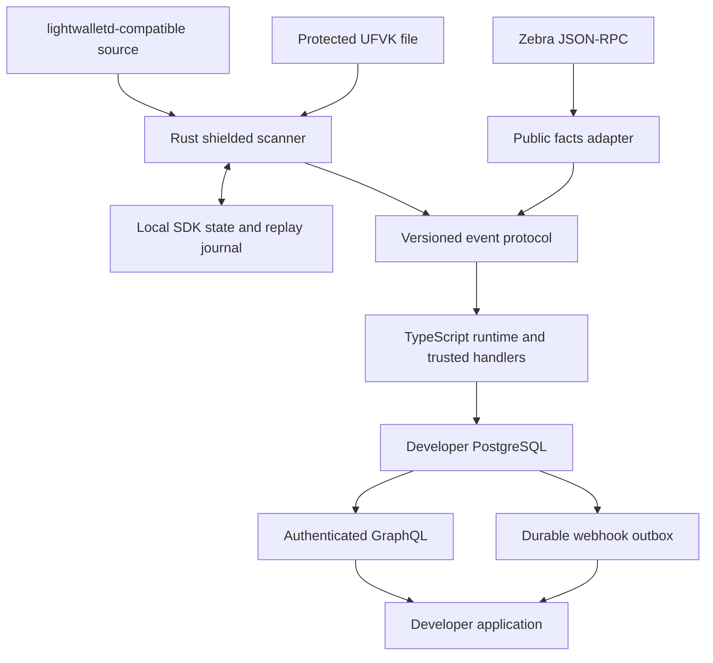

# Zeer v0.1 implementation plan

Date: 2026-10-12 (Asia/Jakarta).
Last planning update: 2026-10-14 (Asia/Jakarta), public Chef, measured Prep retrieval improvements and bounded batch APIs.
Status: **This is the historical full-framework proposal. The active 20 October roadmap now includes an authorized, bounded local receipt preview; see [the current slice](../../plan.md#current-slice-generic-shielded-receipts-20-october). Its stateless full-transaction design does not claim completion of the SQLite/lightwalletd/two-store gates below.** This older proposal does not authorize additional execution by itself.
Result policy (2026-10-14): all benchmark outputs and reports are local-only; this supersedes earlier result-publication requirements.
Scope: independently usable Core & Tooling prototype; existing ZeeSwap project remains separate.

Upcoming implementation order and the public-data release gates are maintained
only in the [active roadmap](../../plan.md#active-roadmap-public-data-mvp-to-28-october).
The historical gates below do not supersede that roadmap or reopen private scanning.

The user subsequently authorized a pinned ShieldedLabs CipherScan review and
relevant independent improvements. [Batch lookup and capabilities](../../docs/PREP_QUERY.md)
are implemented; this does not reopen private scanning or copy the reference
repository's differently licensed code.

## 0. Accepted product names and planning order

The 2026-10-14 public-only Chef decision supersedes the scanner-first sequence
below for the active slice. Historical G1/two-store/outbox requirements are not
claimed complete by public PostgreSQL indexing. Benchmark Chef's durable handler
pipeline separately from Prep retrieval and supplementary prepared lookups.

The user accepted **Zeer Prep** and **Zeer Chef** on 2026-10-13. **Zeer** remains the umbrella brand and existing monorepo name.

| Product | Responsibility | Priority |
| --- | --- | --- |
| Zeer Prep | Retrieve, prepare and supply Zcash chain data through a proposed batch/stream API and client SDK; analogous product layer to HyperSync | First: establish workload, source bottlenecks, correctness and a bounded data-engine design |
| Zeer Chef | Process chain observations and authorized shielded receipts using developer schemas and TypeScript handlers, persist application entities and expose GraphQL; analogous product layer to HyperIndex | Later application-framework phase |

The kitchen analogy is preparation followed by cooking: Prep supplies ingredients ready for application processing; Chef applies the developer's recipe. Consumers may use Prep directly without Chef. These are accepted product names and intended roles, not implemented capabilities or registry/package names.

This direction supersedes the earlier framework-only priority. Sections 1 onward preserve the **Chef framework proposal**, including its scanner, PostgreSQL, GraphQL and recovery contracts. They are not a technical specification for Prep. Prep's first bounded snapshot architecture is documented in its separate engine contract; scalable storage, additional sources/transports and later release gates still require work. Do not assume the Chef architecture applies to Prep.

The next benchmark question is bulk historical data retrieval on equivalent outputs, with fetch/transfer, decoding, authorized scanning and persistence costs measured separately. The existing 128-transaction lookup results do not establish a bulk-ingestion or shielded-scanning advantage. After accepting these names, the user separately authorized Prep implementation. The first slice is defined by [the Prep contract](../../docs/PREP_ENGINE.md); package publication and hosted-service rollout remain outside this work.

## 1. Product and evidence boundaries

**Product in the framework proposal below: Zeer Chef**, an open-source, self-hosted indexing framework that turns Zcash chain observations and authorized shielded receipts into developer-defined entities and a GraphQL API.

**Primary user:** a backend developer building Zcash payment tracking, accounting views, or a relayer's read-side integration.

**Primary demonstration:** a standalone payment-reconciliation example with known invoice references. It must work without ZeeSwap. A second public-data example demonstrates that the framework is reusable.

**Developer promise:** configure a source and storage, define a schema and TypeScript handlers, run Zeer, query the resulting data. The initial goal is less integration work with explicit data guarantees, not a claim to be the fastest Zcash indexer.

| Item | Evidence/status |
| --- | --- |
| Zeer name | Accepted in conversation; namespace/domain/trademark availability not established |
| Brand asset | `../../assets/brand/zeer-logo-concept-v2.png` is an approved PNG concept sheet |
| Framework direction | Zeer Chef retains the application-framework role; Zeer Prep is now the first data-engine priority, as defined in section 0 |
| Developer language/output | Accepted: TypeScript developer surface and GraphQL as primary query interface |
| Hosting/database | Accepted: self-hosted, developer-owned database; framework owns its schemas and consistency |
| Open source | MIT selected for original Zeer project material; dependencies retain their own licenses and require inventory |
| Benchmarking | Required, including genuine external indexer comparisons |
| Current implementation | None found in this workspace on 2026-10-12; not a Git repository |
| Repository direction | Accepted 2026-10-13: one core monorepo under the user's personal GitHub account |
| Technical choices below | Proposed design, not a claim of existing capability |

Tagline proposed earlier: **Zcash data. Ready to build.**
Chef descriptor: **The TypeScript indexing framework for Zcash.**

The organizer screenshot supplied by the user allows two submissions in distinct tracks. ZeeSwap targets Cross-chain and Zeer targets Core & Tooling. Keep separate product scope, examples, evidence and submission narratives; disclose shared components. Organizer guidance is not a promise of a prize or acceptance. Recheck live submission requirements before release; no deadline is assumed by this plan.

## 2. Scope contract

### Required for the v0.1 prototype

1. A local CLI that validates configuration, starts the runtime, reports progress, and explains failures.
2. Rust integration using maintained Zcash libraries; no new cryptography.
3. A lightwalletd-compatible source adapter for shielded scanning, selected and pinned after G0.
4. A bounded Zebra JSON-RPC public-data adapter for block/transaction facts. Request limits, retries and protocol parsing must be explicit.
5. Orchard and Sapling receipt scanning as separate tested capabilities. A partial-pool build is a documented spike, not completion of this scope. Other pools/upgrades require capability checks; do not silently skip an active unsupported protocol.
6. Dedicated watch-only accounts imported through UFVKs and an explicit birthday/checkpoint. Source/library support is proved in G1.
7. Generated TypeScript entity types and deterministic handler execution.
8. PostgreSQL application storage supplied by the developer. Local PostgreSQL is the reference profile; Neon is a separately verified compatibility profile.
9. Read-only GraphQL, protected by a per-deployment token and a constrained generated query surface.
10. Historical processing, live following, crash recovery and bounded reorg handling.
11. Optional signed webhooks using a durable outbox; downstream delivery is at least once.
12. Public benchmark harness and standalone example; external comparison results and correctness evidence retained locally.

### Explicitly outside v0.1

- Hosted Zeer Cloud, billing, public multitenant hosting, accounts shared between unrelated customers.
- Full-node consensus validation and mining. A separate global data archive is outside this Chef framework proposal; Prep's bounded data-service scope is pending its own design.
- Spending keys, mnemonic import, transaction signing, swaps, bridges, custody or a payout engine.
- Complete wallet balances, exhaustive outbound transaction accounting, sender identification or deanonymization.
- Mempool payment events; only mined chain observations enter the v0.1 event contract.
- Transparent-address balance/history indexing, prevout resolution, historical price feeds and fiat valuation.
- Unrestricted GraphQL relations/joins, REST parity, subscriptions, live dashboards or a visual schema builder.
- NPM publication, GitHub repository creation, domain purchase or mainnet readiness claims during planning.

Public block/transaction facts remain in scope for framework utility and comparison; do not add an explorer's entire feature set just to enter a leaderboard.

## 3. Architecture decision

### Selected design

Use a Node/TypeScript coordinator plus a local Rust scanner child process. PostgreSQL holds application projections and runtime transaction state. The SDK's local SQLite-backed wallet state remains a separate developer-owned persistent volume. Treat that volume as sensitive, including any imported viewing-key material.



One deployment owns one project, one network, one PostgreSQL namespace, one scanner data directory and a configured set of accounts under the same operator. Multiple unrelated projects use separate deployments and credentials. Runtime handles one canonical block batch at a time initially; parallel fetching/decryption can be added only if ordered commits remain identical.

### Why this design

| Alternative | Advantages | Costs / decision |
| --- | --- | --- |
| Rust child process + TypeScript runtime | Reuses Zcash Rust libraries, isolates scanner failures, preserves TS developer API | Chosen; requires explicit IPC and two-store recovery proof |
| Node native addon / WASM | Potentially convenient packaging and reduced IPC | Defer; native ABI/platform work and WASM limitations would expand the initial risk |
| Entire runtime in Rust | Fewer cross-language boundaries | Does not satisfy the agreed TS handler experience without another extension layer |
| Rewrite SDK storage into PostgreSQL | Could share more transactions | Reject for MVP; implementing the wallet persistence/tree interfaces greatly expands scope |

The official backend supports viewing-key scanning and references a SQLite persistence implementation [S1-S3]. These facts justify reuse, not an assumption that Node and SQLite/PostgreSQL recovery is already solved.

### Proposed packaging

- `packages/cli`: configuration, process lifecycle, doctor/status commands.
- `packages/sdk`: public TS event, handler and entity types.
- `packages/runtime`: ordered processing, SQL adapter, undo journal and outbox.
- `packages/graphql`: SDL validation, query generation and authorization.
- `crates/zeer-scanner`: Rust scanner, library integration and replay protocol.
- `examples/public-chain`: block/transaction facts.
- `examples/shielded-invoices`: private receipt reconciliation.
- `benchmarks/`: separate reproducible harness, never imported by runtime.

These paths are planned, not existing files. Keep module boundaries logical; avoid distributing six separately published packages for the first demo. Package names are provisional until availability is checked.

Linux x86_64 is the initial deployment target; Windows developers use WSL2 for the validated path. Native Windows/macOS binaries are later compatibility work. Pin exact tested Node, Rust, PostgreSQL, crate and source versions in G0/G1; never release against floating `latest`.

## 4. Developer contract

### Configuration and commands (proposed, not runnable yet)

```ts
export default defineConfig({
  project: "merchant-demo",
  network: "testnet",
  schema: "./schema.graphql",
  handlers: "./src/handlers.ts",
  startHeight: 123456, // inclusive application history start; actual value is deployment-specific
  databaseUrlEnv: "DATABASE_URL",
  sources: {
    lightwalletdUrlEnv: "ZCASH_LIGHTWALLETD_URL",
    zebraRpcUrlEnv: "ZEBRA_RPC_URL", // required only for public facts
  },
  accounts: [{
    id: "merchant",
    ufvkFileEnv: "MERCHANT_UFVK_FILE",
    birthdayHeight: 123456, // illustrative; obtain the actual birthday
  }],
  confirmations: 10, // illustrative policy, not a universal safety threshold
  memoPolicy: "omit", // set explicitly to "decode" for the invoice example
  reorgWindow: 100, // proposed only; must fit proven SDK retention
});
```

The account birthday identifies the inclusive earliest height to scan. Obtain the preceding tree state and verify network/height/hash coherency. A too-recent birthday omits earlier receipts; never report a complete wallet history or balance from it. Account additions and policy/source/schema changes require stopped, explicit migration/replay workflows; hot reconfiguration is deferred.

`startHeight` bounds emitted application history. A configured account birthday must be at or before that height; the scanner may need to process earlier birthday blocks for SDK state, without emitting application mutations before `startHeight`. When public and shielded adapters are both enabled, the coordinator joins their complete batches on network, height and block hash and commits only their common ready range. It must not merge one provider's replacement block with another provider's orphaned block. Public-only deployments do not require keys or scanner state; shielded-only deployments do not require the public-facts adapter.

| CLI command | Contract |
| --- | --- |
| `zeer init` | Generate a small public or shielded example without credentials |
| `zeer doctor` | Check versions, DB permissions, source capabilities/network and key-file readability without printing secrets |
| `zeer codegen` | Validate supported SDL and emit handler/entity types; compile failures must occur before runtime |
| `zeer migrate` | Explicit, versioned changes in a dedicated namespace; no deletion of developer tables |
| `zeer dev` | Foreground development supervisor; DB must be supplied or explicitly started through the example Compose profile |
| `zeer start` | Run prebuilt code and scanner; fail if schema/code fingerprints differ |
| `zeer status` | Report source tip, scanned height, enriched height, committed height, lag, queue depth and health |
| `zeer replay` | Rebuild into a new projection generation, preserving current data and disabling outgoing deliveries by default |

### Entities and handlers

Supported SDL starts with `ID`, `String`, `Boolean`, `Int` and a custom `BigInt` serialized as a decimal string. `id: ID!` is required. No arbitrary JSON, custom executable directives, recursive relations or user-defined SQL in v0.1. Zatoshi values are validated integer strings across IPC/GraphQL and `bigint` in TS arithmetic; never JS floating point.

```graphql
type Receipt {
  id: ID!
  accountId: String!
  txid: String!
  amountZatoshis: BigInt!
  pool: String!
  blockHeight: Int!
}
```

```ts
// Illustrative API contract. A received note is not proof of an external customer payment.
indexer.on("shielded.note.received", async ({ event, context }) => {
  await context.Receipt.set({
    id: event.noteId,
    accountId: event.accountId,
    txid: event.txid,
    amountZatoshis: BigInt(event.amountZatoshis),
    pool: event.pool,
    blockHeight: event.blockHeight,
  });
});
```

Entity `get/set/delete` and a constrained query API operate through the runtime transaction. The public type model is generated from the schema. Capture before-images for framework-managed writes. Handler order is declared and stable. Within each block, phases are block-applied, public transaction observations, received notes, then newly crossed confirmation thresholds. Within a phase use transaction position, explicit pool order, output/action index, then account ID; older notes crossing a threshold sort by original inclusion height followed by that tuple. With confirmations=1, receipt always precedes confirmation. Record the pool-order enumeration in the protocol version rather than relying on map iteration order.

Handlers are trusted operator code, not an untrusted sandbox. The supported contract forbids unrecorded network calls, wall-clock/random inputs and direct SQL writes because they break replay/rollback. Raw Node code can violate this contract; document the trust boundary and check supplied examples. External side effects go through the outbox only. On handler error roll back the whole application batch and do not advance its checkpoint; do not silently skip failed events.

## 5. Source and event semantics

### Read-path requirements

1. Bind to an expected network, genesis identity, source capability set and protocol versions. Refuse mismatches.
2. Read compact blocks for receipt discovery; validate ordering and continuity through the library.
3. For discovered relevant transactions, fetch full transaction bytes and perform the library's full decryption/consistency checks before publishing the complete receipt event. Compact data does not contain the full memo [S4].
4. Match raw transaction identity and its claimed inclusion to the block/source view. Cross-source hash disagreement triggers reconciliation, not a fallback merge.
5. Advance `enrichedHeight` only when required enrichment for all accounts in that range is complete. Temporary full-transaction failure causes retry and visible lag, never an invented empty memo or dropped note.
6. Emit a complete ordered batch. Check latest canonicality before the runtime commit, while acknowledging that a later reorg is still possible.

Network trust: SDK continuity/decryption checks are not independent full-node consensus validation. A remote source can omit data, lag, or observe access patterns. The strongest initial profile uses the operator's own validated Zebra-backed source. Fetching only relevant full transactions may reveal which transactions interest the client; make this limitation visible. No network-anonymity claim.

### Events

| Event | Meaning / boundary |
| --- | --- |
| `chain.block.applied` | Coherent block facts accepted for this pipeline |
| `chain.transaction.observed` | Public transaction facts obtained through the public adapter |
| `shielded.note.received` | A validated decryptable note for a configured account, mined in a known block |
| `shielded.note.confirmed` | The note crossed the configured confirmation policy on the observed canonical chain |
| `chain.reverted` | A previously applied block range is removed; generated as a control notification after transactional rollback |

`chain.reverted` is not a user mutation handler in v0.1. Framework undo restores application state; the notification describes the rollback. Confirmation handlers execute as part of the block that first makes the threshold true, so undo covers them too.

Stable logical note identity: network + configured account identity + txid + pool + output/action index. Transaction ID alone is insufficient: a transaction can contain multiple relevant outputs. Reject duplicate/overlapping imported account keys rather than double-counting them.

Observation identity additionally includes block hash and event kind. Journal sequence and chain generation distinguish repeated branch transitions. Each newly enqueued delivery receives a random 128-bit identifier, persisted with an immutable payload digest, project lineage, delivery epoch and ordered sequence. Retrying a delivery keeps its ID and body; a sequence number alone is never its identity. Reappearance after reversion is a new observation/delivery transition referring to the same logical note. Restoring old outbox history must create a new delivery epoch before new live deliveries; new IDs must never collide with previously delivered content.

Minimum note payload: protocol version, event/observation/note IDs, network, account ID, txid, pool, output index, amount, block height/hash, transaction position, recipient reference when available, and memo status. The framework does not invent a sender address.

Memo status is one of `OMITTED_BY_POLICY`, `ABSENT`, `TEXT`, `BINARY`, `INVALID_ENCODING`; binary bytes are encoded explicitly. Preserve supported protocol bytes and classify through library semantics, never regex guessed from encrypted bytes. Memo is untrusted application input; it is not sender authentication, code, an amount oracle or authority to transfer funds. Rendering must escape it. Default event/API/outbox schema excludes memo; the invoice example opts in deliberately.

Receipt classification distinguishes library-supported internal/change evidence from unknown origin; do not infer external payment from memo text. Label `UNKNOWN` where evidence is insufficient. An invoice example must specify its own acceptance policy and never count recognized internal change as a new customer payment. ZIP 310 describes relevant Sapling viewing-key limitations [S5]; do not generalize every Sapling detail to other pools without validation.

Observation status transitions: `OBSERVED` then `CONFIRMED`, either may become `REVERTED`. Re-inclusion can return to `OBSERVED/CONFIRMED`. Store a reversible canonical receipt projection separately from append-only observation/transition history. Undo removes an orphaned receipt from the canonical projection but appends a reversion to history. The built-in current receipt lookup then returns no canonical receipt; the status/history lookup can still return `REVERTED`. Rolling back only its confirmation-triggering block leaves the canonical receipt observed. Compare canonical projections, not historical transition logs, against clean replay. Confirmation count is based on the pipeline's coherently committed head, not an unrelated fast-moving provider tip. Confirmed is policy satisfaction, not irreversibility.

No `balance` field in v0.1. Receipt totals are not available/spendable balances, and UFVK support does not justify claiming complete outgoing history.

## 6. Persistence, replay and recovery

### Stores and ownership

| Store | Owner / content |
| --- | --- |
| Local persistent scanner directory | Developer; SDK SQLite state, scan cache, sensitive normalized event journal and lineage metadata |
| PostgreSQL `zeer_meta`-style namespace | Framework; configuration fingerprints, canonical block journal, checkpoints, entity undo, processed batches, append-only observation transitions, reconciliation control and outbox |
| Dedicated application namespace | Framework-managed entity tables from developer SDL; do not mix with unrelated business tables |
| API read role | Restricted access to generated views/tables; no key or private runtime journal access |

Backups must include a documented lineage manifest, network/hash, generation, scanner cursor and application cursor. SQLite must use a supported consistent backup method, not an arbitrary copy of a live file. Restored deployments start with webhook delivery disabled until lineage and source reconciliation pass.

### Rust/TS protocol

Preferred transport: local child-process stdin/stdout with versioned bounded JSONL messages, decimal-string integers, protocol handshake, request IDs, network fingerprint, block ancestry, batch hash, cursor and acknowledgement. Large batches use ordered bounded chunks and a final count/hash manifest; partial batches cannot commit. Stdout carries protocol only; stderr carries redacted operational logs. No listening scanner port in v0.1. Key content is never passed in command-line arguments or logs; pass a protected file reference. Node must reap the child on shutdown and handle partial lines, EOF and crashes.

Start with one unacknowledged application block batch and bounded fetch prefetch. Set explicit frame, queue, payload and scanner-disk limits during G1. Apply backpressure when PostgreSQL lags; a full disk pauses scanning visibly without pruning unacknowledged data. An oversized batch is a reported unsupported-input/resource condition, never a skipped block. Include slow-consumer, truncated-frame and disk-limit fault tests.

Runtime requests ranges based on the PostgreSQL committed cursor. Rust must support repeatable retrieval of earlier completed batches, not merely stream whatever comes after its latest SDK scan height.

**Hard invariant:** scanner progress may be ahead of application progress; neither side may silently skip the gap. Acknowledgement is sent only after the PostgreSQL transaction has durably committed.

### Normal processing protocol

1. Scanner prepares a normalized, enriched batch and durably records enough information to re-emit it after restart.
2. If SDK state and the local journal cannot share one transaction, use a persistent prepare/complete record and deterministic reconstruction from retained chain data. Publishing is forbidden until completion. G1 must prove every interruption point; do not assume cross-database atomicity.
3. Runtime checks batch identity, parent hash, schema/handler fingerprints and active generation.
4. In one PostgreSQL transaction: record the applied block/batch, execute all handlers, record before-images and processed observations, advance the application checkpoint, enqueue deliveries.
5. Commit; then acknowledge. A lost acknowledgement causes a duplicate batch that PostgreSQL recognizes without reapplying mutations or creating new deliveries.

The exact SDK query/reconstruction API is a G1 feasibility question. If durable replay cannot be proved, stop dependent implementation and revise the design. A mocked acknowledgement path is not acceptance evidence.

Single writer per project: use an explicit database ownership row with a renewable lease and fencing token. Every commit checks fencing ownership atomically. Lease expiry alone does not authorize old work to commit. This applies to normal writes, reconciliation, restore/cutover control and dispatcher claims/results. Claim deliveries with a token/epoch check; check again before I/O and when recording its result. Fencing cannot retract an HTTP request already in flight, so ambiguous delivery remains part of the contract. Do not rely on a session advisory lock or LISTEN/NOTIFY across transaction-pooling connections. A local scanner lock also prevents two runtimes sharing one SQLite directory.

### Reorg handling

1. Persist a fenced reconciliation operation before rollback: operation ID, previous head, candidate ancestor, expected source/network identity and phase. Block normal application commits, entity reads and new dispatch while it is active.
2. Locate/revalidate a common ancestor using retained block hashes. Require compatible scanner rewind state and entity undo records; never assume a previously selected ancestor remains canonical after restart.
3. In transactional reverse order, undo orphaned application writes, invalidate their observations, cancel only never-attempted notifications, reset confirmation transitions/checkpoint, append history reversions and enqueue reversion notifications for every potentially externally observed transition. That includes HTTP attempts with unknown outcomes. Keep operational outbox/history separate from reversible application state.
4. Persist `APPLICATION_REWOUND`, then request scanner rewind/reconstruction tagged with the operation ID and target hash. Invalidate orphaned local journal batches and verify the library's returned height. Record the scanner acknowledgement and phase durably. If a crash occurs, resume this operation before honoring any normal scan request.
5. Replay the verified replacement branch under reconciliation control. Move through `SCANNER_REWOUND` and `REPLAYING` to `COHERENT` only after both stores agree at the recorded head. Recheck source canonicality before clearing the control state and resuming reads/dispatch.
6. If ancestor/SDK retention/undo is insufficient, set `REBUILD_REQUIRED`, stop writes/delivery, and require an explicit generation rebuild. Never continue from inconsistent cursors.

Commit each rollback unit and its reconciliation progress marker in the same PostgreSQL transaction; retrying the operation must not apply before-images twice. If the entire rollback is one transaction, commit `APPLICATION_REWOUND` with it. Partial rollback progress must be durable and resume in the recorded reverse order.

Test interruption immediately before/after the PG rollback, scanner rewind, rewind acknowledgement, replacement replay and clearing the reconciliation state. Incomplete control records take precedence over ordinary restart behavior. A chain change during reconciliation updates the target through another recorded phase rather than serving stale journal batches.

Default proposed undo window is 100 blocks, but G1 must test the minimum of actual SDK rewind retention and application retention. G3 tests depths 1 and 10, exactly the effective boundary, and one deeper. Pruning cannot remove data necessary for unacknowledged batches or rollback within the advertised window.

A webhook may race with a newly detected reorg or already have reached an external system. Reversion cannot undo a payment or email. Payloads include status/generation/sequence, consumers deduplicate and reconcile, and the example never automatically sends money.

### Replay, restore and schema changes

- Handler/config/schema fingerprints bind a projection generation. Changing handler semantics requires replay; additive schema changes still have an explicit migration path.
- Build into a fresh namespace/generation. Canonical replay compares to the source; old snapshots remain reviewable until the replacement passes validation.
- Replaying history suppresses webhooks by default. Cutover and the initial live delivery watermark are explicit; never resend historical financial notifications on an automatic restore.
- Restoring an older snapshot or losing outbox history requires an explicit recovery operation, a fresh randomly generated delivery epoch and a continuity-reset notification before new live transitions. Consumers refresh canonical state and reconcile across the epoch boundary; deduplication alone cannot reconstruct lost history. Existing delivery IDs/payloads stay bound, and newly queued content receives fresh random IDs even if a restored sequence repeats. Test a receiver that already accepted events newer than the restored snapshot.
- If only PostgreSQL is behind, re-emit from retained scanner journal or rescan. If only SQLite is behind, rescan from a valid checkpoint. If lineage is incompatible or required material is missing, rebuild with delivery disabled.
- Default runtime reads remain available during a source outage with freshness metadata; writes and delivery pause if coherent state cannot be established. Reorg reconciliation marks the API unavailable for normal entity reads until the snapshot is coherent.

## 7. GraphQL, webhooks and privacy

### Query API

- GraphQL Yoga + `graphql` with `pg` is the proposed lean stack; verify current supported versions at implementation. Avoid a mandatory Hasura control plane for the MVP.
- Generate read-only root fields with `byId`, bounded cursor pagination, scalar equality filters, and fixed allowed ordering. SQL values are parameterized; schema names/identifiers are validated and generated.
- Example limits: 100 rows/page, depth 5, bounded aliases and query complexity, request/SQL timeout. These are proposed defaults to test, not performance guarantees.
- One token authorizes the whole deployment/project. Accounts within the same project are not separate security tenants. Unrelated projects need separate deployment credentials/storage. Bind localhost by default, restrict CORS and require TLS termination for remote access.
- API examples use a backend caller. Never place a project-wide private API token into a public browser bundle. A merchant backend exposes only the specific customer data it authorizes.
- Each response exposes `_meta` with committed block height/hash, generation, source health and last successful source observation. Execute data and metadata under a consistent read snapshot. A pagination cursor encodes generation/head and filter/order fingerprint. In v0.1 reject continuation with `CURSOR_SNAPSHOT_CHANGED` whenever the current committed head differs, including normal forward progress, cutover or reorg. The caller restarts pagination; uninterrupted multi-page reads during rapid indexing are not promised. Do not pretend to hold a database snapshot across HTTP requests. Test inserts/deletes/filter/order changes between pages during ordinary indexing.
- Confirmation counts are derived from that snapshot. Built-in receipt status remains available separately from arbitrary developer entities.
- There is no anonymous public mode in v0.1, even when the indexed source data is public. A private deployment must never become public because the user omitted a flag.

### Webhook contract

- Explicit endpoint allowlist configured by the operator; memo content never chooses destinations.
- Durable PostgreSQL outbox, HMAC-SHA256 over timestamp plus exact body bytes, key version, event ID and per-project sequence. Example receiver verifies signature/time and deduplicates deliveries.
- Persist an attempt before making the HTTP request. Distinguish `NEVER_ATTEMPTED`, `ATTEMPTED_UNKNOWN` and `ACKNOWLEDGED`; a timeout does not prove the consumer did not receive the event. Reorg/reset handling reconciles all potentially observed transitions, including unknown outcomes. Recheck fencing/epoch on attempt completion.
- Timeout, bounded exponential retries, visible dead-letter state, operator retry preserving the original delivery ID and payload digest. No exactly-once network delivery claim.
- Per-endpoint sequencing and stale/reverted delivery behavior must be tested; a consumer can also query current status using the API.
- TLS required outside localhost development. Raw memo and receiver details are excluded unless explicitly mapped into the payload.

### Threat model and acceptance boundaries

| Threat | Required mitigation / limitation |
| --- | --- |
| Viewing key disclosure | Sensitive file and scanner-volume permissions; no raw key in logs, API, PG entities or benchmark output; no spending-key ingestion |
| Operator learns private data | Explicit self-hosted trust model; UFVK is broad read authority, not a per-invoice permission |
| Shared key cannot be revoked cryptographically | Deleting local files stops this scanner; it does not revoke copies held elsewhere; use dedicated accounts |
| Private data in plaintext storage | Document that Node/SQLite/PG/authorized handlers can read decoded data; operator uses encrypted disks/backups/TLS as appropriate |
| Cross-project reads | Separate namespace/deployment/token and negative authorization tests; metadata tables never queryable |
| Source surveillance/omission | Document provider trust and access-pattern leakage; no anonymous traffic or independently validated-chain claim |
| Malicious memo | Treat as bytes/text only; schema/length validation, safe rendering; no signing or arbitrary network execution |
| Duplicate or change mistaken for revenue | Stable note identity, internal/unknown classification, independent invoice checks and fixtures |
| Exfiltration through handlers | Handler code is trusted, reviewed operator code; framework is not a sandbox |

Privacy tests use synthetic canary keys/memos and separate project datasets; secret scanning checks logs, API errors and saved reports. This tests specified leak paths, not a proof of anonymity or cryptographic security.

## 8. Benchmark contract

[The benchmark specification](../../docs/BENCHMARK_SPEC.md) is authoritative for cases and methodology.

Minimum evidence before submission:

1. Public-data comparison with at least one actual external Zcash indexer on an eligible, declared workload.
2. Shielded scanning characterization against a clearly labelled direct-library baseline.
3. GraphQL performance with fixed queries/data/concurrency and indexing both idle and active.
4. Restart/outage/reorg/privacy correctness gates, independently of performance ranking.
5. Raw results, exact versions/configuration, dataset manifest, expected output and reproduction commands.

Zaino/lightwalletd/Zinder are generally provider variants for this framework, not automatically direct peers. CipherScan is a candidate for overlapping public facts; eligibility must be demonstrated before naming it in a speedup chart. Report unavailable cases and mixed-workload comparisons explicitly. No requirement that Zeer wins every measurement.

## 9. Implementation gates

Every gate produces a short evidence record with commands, exact versions, result, failure cases and remaining limitations. Check source diffs and workspace state after each bounded task. Benchmark evidence is stored locally under `benchmarks/results/` and excluded from Git. The older shielded/two-store gates below remain a proposal; executed Prep work and the superseding public-only Chef slice are tracked in their contracts and [current project plan](../../plan.md).

Engine-first sequencing clarified on 2026-10-13: implement scanner and transactional runtime through internal runners before polishing the public SDK/CLI. Freeze basic wire/handler contracts early; collect scanner and persistence benchmark baselines as soon as correctness allows. G2 is the minimal runtime/query integration needed to prove the engine, G4 measures the connected pipeline, and G5 completes developer-facing packaging. Re-run affected end-to-end measurements after packaging changes. Repository setup is administrative preparation, not completion of any implementation gate.

### G0 - Freeze dependencies, capabilities and benchmark feasibility

Proposed outputs: `docs/COMPATIBILITY.md`, `docs/evidence/G0.md`, dependency lockfiles when implementation begins, `benchmarks/manifests/`.

- Inventory supported source/library versions and active protocols on the chosen test network.
- Verify UFVK watch-only import, account birthday/tree state, receipt iteration, full memo decoding and rewind API shapes from the pinned library.
- Select one reference lightwalletd-compatible source plus a coherent Zebra RPC source; test network/capability mismatches.
- Verify CipherScan can build/run on a compatible node/state and identify an eligible comparison case. If not, evaluate a documented alternate external indexer on overlapping work; a made-up baseline cannot replace the external comparison requirement.
- Record hardware/storage requirements, existing infrastructure availability and dependency licenses. Do not purchase resources implicitly.
- Check proposed GitHub/npm/CLI namespaces without reserving or publishing them.

Pass: compatibility matrix and runnable experiment recipe, with every unknown marked; at least one external comparison has a concrete installation/workload path. No source capability or package-name claim based only on branding.

### G1 - Prove the shielded read path and crash-safe replay

Proposed files: `crates/zeer-scanner/`, `packages/sdk/src/protocol.ts`, `docs/evidence/G1.md`, synthetic fixtures.

- Import a dedicated test UFVK without mnemonic/spending key; scan a known birthday range.
- Detect exact Orchard and Sapling fixture outputs; cross-check amount, output identity and memo against independent sender/recipient evidence.
- Include unrelated outputs, multiple outputs in one transaction, binary/empty memo, recognized change/self-transfer and unknown-origin cases.
- Prove local batch journal reconstruction across crashes before/after SDK state writes, enrichment, journal completion and protocol emission.
- Prove repeatable range retrieval after scanner restart and verify effective rewind retention.
- Capture an initial scanner-only timing/resource baseline on the frozen correct fixture; label it separately from framework or chain-to-GraphQL performance.
- Validate IPC chunk framing and bounded queues under a slow consumer, partial frame, oversized input and scanner disk limit.
- Demonstrate one actual public-testnet receipt from an independently operated wallet. Any actual send requires its own scoped transaction authorization; previously accepted research/planning does not authorize spending.

Pass: zero incorrect/missing/unexpected notes in fixtures, matching testnet receipt evidence, repeatable batches after crash, and no keys/memos in logs. SDK-only or local fixture proof is labelled accordingly and is insufficient for the live-testnet requirement.

### G2 - Prove the transactional runtime and minimal query slice

Proposed files: internal runner, `packages/runtime/`, `packages/graphql/`, basic SDK/schema contracts, `examples/shielded-invoices/`, `examples/public-chain/`.

- Implement limited schema/codegen, PostgreSQL migrations, transactional handlers and the two adapters.
- Use a minimal internal runner; interactive onboarding, polished TUI and distributable public CLI are deferred to G5. Measure persistence and Rust/TS boundary overhead once output correctness is established.
- Add IPC identity/deduplication, fencing and commit/ack behavior.
- Generate authenticated read-only GraphQL with freshness metadata and snapshot-bound pagination.
- Invoice reference data belongs to the example's business backend. Chain-derived projections are rebuilt independently; runtime does not roll back unrelated invoice creation records.

Pass: from the documented clean setup, both examples produce exact expected entities through GraphQL; restart does not duplicate rows; wrong credentials/unsupported SDL fail clearly; source/schema/handler fingerprint mismatch is rejected.

### G3 - Prove rollback, restore, isolation and delivery semantics

Proposed files: runtime recovery/outbox modules, integration/fault fixtures, `docs/evidence/G3.md`.

- Reorg tests at specified depths and beyond retention; correct undo of aggregates and confirmation-triggered writes. Crash at every reconciliation phase and verify that current receipt lookup, retained history and re-inclusion semantics agree.
- Kill processes at each commit boundary; source/DB outages; expired leases and stale writers; SQLite-only and PG-only restoration.
- Signed webhook retry/reversion ordering, invalid signature, duplicate delivery and replay suppression. Include accepted delivery with lost HTTP response followed by reorg, plus snapshot restore with previously delivered higher sequences; no delivery ID may be reused for different content.
- Unauthorized project API requests, query limits, SQL injection inputs, memo rendering and secret-canary tests. Exercise pagination invalidation under normal forward indexing as well as reorg/cutover.

Pass: canonical entity result matches clean replay; no lost or duplicate logical records, no stale-writer commit, no private cross-project response, deep reorg fails closed, replay does not automatically reissue historical deliveries.

### G4 - Execute reproducible benchmarks

Proposed files: `benchmarks/`, `docs/evidence/G4.md`, machine-readable raw result files.

- Run the frozen methodology against at least one eligible external indexer, a direct-SDK baseline and Zeer.
- Separate cached engine experiments, native-stack experiments and live-source observations.
- Characterize key-count scaling and memo enrichment cost; measure GraphQL under load and indexing.
- Include correctness failures and timeouts in reports; publish no performance winner for failed data.

Pass: five-run reported distributions for primary performance cases, full finite-dataset equality, versions and commands reproducible, comparison caveats visible. No unmeasured performance claims.

### G5 - Package the public developer prototype

Proposed files: completed public SDK and CLI, root README/license/dependency notices, docs, reproducible example Compose profile, CI and release artifacts.

- Fresh Linux/WSL2 setup walkthrough; explicit prerequisites, source readiness, BYO database and scanner volume instructions.
- Finish the single-package npm distribution, supported-platform scanner packaging, CLI onboarding/status and stable developer imports. Test the packed artifact in a clean consumer project before any registry publication; repeat affected benchmarks.
- Target: first fixture-backed GraphQL result within 30 minutes after prerequisites/source availability; measure actual time rather than promise it.
- Separate local-fixture demo from live testnet proof; public-data example and invoice example both runnable.
- Two-hour testnet following soak with reconnect/restart, final reconciliation and recorded resource use. This is prototype evidence, not production reliability certification.
- Submission assets explain distinct track/product, read-key privacy boundaries, measured benchmarks and limitations. Use the selected raster logo as a concept; vector identity work is separate.

Pass: another clean environment reproduces the documented flow; evidence links resolve; all required gates pass or remaining gaps are explicitly stated without claiming completion. Repository/package publication and submission remain separate user-directed actions.

## 10. Risk register and stop rules

| Risk | Early proof / response |
| --- | --- |
| Rust watch-only adapter cannot produce replayable historical notes | G1 journal/reconstruction spike; revise architecture before building GraphQL around it |
| New protocol active on selected network unsupported by pinned crates | G0 capability matrix; select supported versions/network fixtures transparently; do not silently skip |
| Crash creates two-store divergence | Inject failures at all boundaries; resume from committed application cursor or require replay |
| Reorg removes effects already delivered externally | At-least-once transition protocol, policy confirmations, reversion events and read-only example |
| Benchmark peers do more/different work | Eligibility manifest; normalized output parity; whole-stack label without misleading speedup |
| Local-source disk/hardware exceeds available resources | Measure preflight needs; bounded compatible dataset/profile; report resource limitation rather than fabricated comparison |
| Framework scope balloons into explorer/wallet/cloud | Scope contract above; new features require explicit plan revision with impact |
| Arbitrary handler makes replay nondeterministic | Trusted-code contract, restricted supported context, deterministic replay comparison and outbox-only effects |
| Privacy leak through API/log/backup | Canary tests, authenticated project boundaries, minimal exports and explicit data ownership |

No dashboard, cloud service, payouts, custom prover or replacement wallet database is a workaround for a failed gate. Record blockers with exact evidence and the smallest experiment that resolves them.

## 11. Design review criteria

- Every persisted checkpoint corresponds to committed work; scanner/application checkpoints have separate names.
- Every public API field has a source, authorization scope and precision definition.
- No full transaction amount, sender identity or customer intent is invented from a memo.
- Recovery outputs equal clean canonical replay, including aggregates and confirmation effects.
- A performance comparison identifies workload, source, output semantics, hardware and versions.
- The implementation plan remains independently useful without ZeeSwap.

## 12. Sources and interpretation

Reviewed official/project-maintained material on 2026-10-12. Repository descriptions establish advertised capabilities, not successful local execution. URLs using `latest`/branches must be replaced with exact tested versions/commits in G0 evidence.

- **S1:** [Zcash client backend data API](https://docs.rs/zcash_client_backend/latest/zcash_client_backend/data_api/index.html): viewing-key-centric scanning, account state and wallet persistence concepts.
- **S2:** [WalletWrite](https://docs.rs/zcash_client_backend/latest/zcash_client_backend/data_api/trait.WalletWrite.html): UFVK account import, birthday and rewind interfaces.
- **S3:** [zcash_client_sqlite](https://docs.rs/zcash_client_sqlite/latest/zcash_client_sqlite/): existing SQLite implementation; not a reason to store keys in application PostgreSQL.
- **S4:** [Compact Orchard data](https://docs.rs/zcash_client_backend/latest/zcash_client_backend/proto/compact_formats/struct.CompactOrchardAction.html) and [full transaction decryption](https://docs.rs/zcash_client_backend/latest/zcash_client_backend/fn.decrypt_transaction.html): compact discovery versus transaction enrichment.
- **S5:** [ZIP 310](https://zips.z.cash/zip-0310): draft informational description of Sapling viewing-key guarantees and limits; not proof of sender identity or a universal policy for every pool.
- **S6:** [Zaino](https://github.com/zingolabs/zaino), [lightwalletd](https://github.com/zcash/lightwalletd), [Zinder](https://github.com/ZcashFoundation/zinder): source/provider candidates; compatibility must be tested per pinned release.
- **S7:** [CipherScan Rust](https://github.com/Kenbak/cipherscan-rust): public-data comparison candidate with different ingestion path and indexing scope.
- **S8:** [Envio benchmark methodology](https://github.com/enviodev/open-indexer-benchmark/blob/main/METHODOLOGY.md): reference for reproducibility and separating correctness, source and performance, not a direct Zcash benchmark.
- **S9:** [Zebra regtest](https://github.com/ZcashFoundation/zebra/blob/main/book/src/user/regtest.md): controlled local testing; fault/reorg scenarios still require verified harness support.
- **S10:** [Wallet threat model](https://zcash.readthedocs.io/en/latest/rtd_pages/wallet_threat_model.html): source trust and request-timing privacy limitations; assess against the pinned SDK rather than assuming all historical statements match current code.
- **S11:** [darksidewalletd](https://github.com/zcash/lightwalletd/blob/master/docs/darksidewalletd.md): candidate controlled source for fault fixtures; tests using it must be labelled simulated-source evidence.

All proposed API names, limits, schemas, paths, acceptance gates and architecture choices are Zeer design decisions, not claims that these sources implement them.

## 13. Planning review record

Two bounded independent design-review passes were completed on 2026-10-12. Findings were incorporated into the recovery, delivery, pagination, observation-history and benchmark timing contracts. The final clarification makes rollback progress atomic with the corresponding undo transaction. This is a review of a proposed design, not an audit or implementation proof.

At the planning review, document checks covered relative-link resolution, balanced code fences, trailing whitespace and workspace inventory; no application tests or benchmarks had run then. Subsequent benchmark-first work is recorded separately in the linked benchmark report. Remaining engine feasibility questions belong to G0/G1; the design review does not establish their completion.
