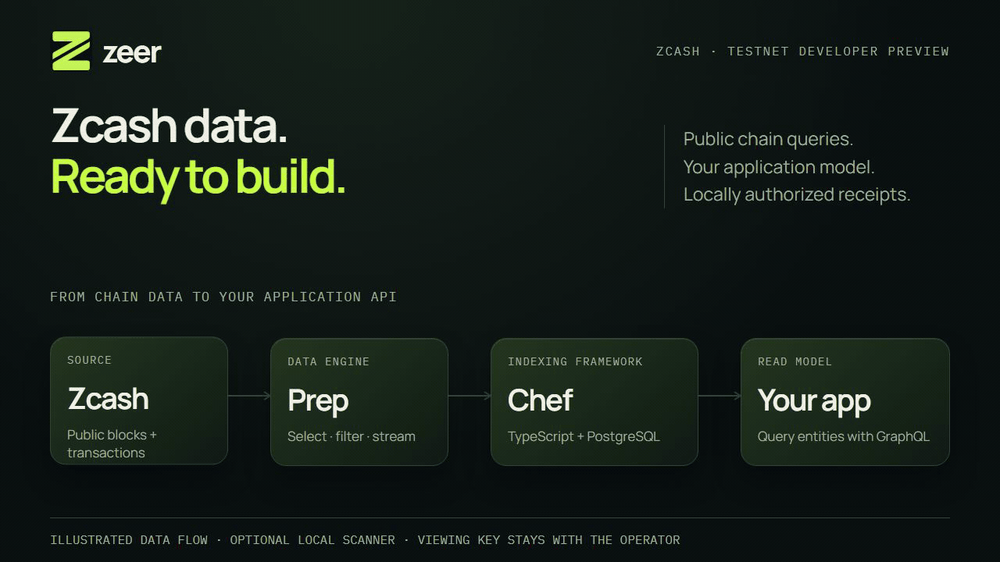
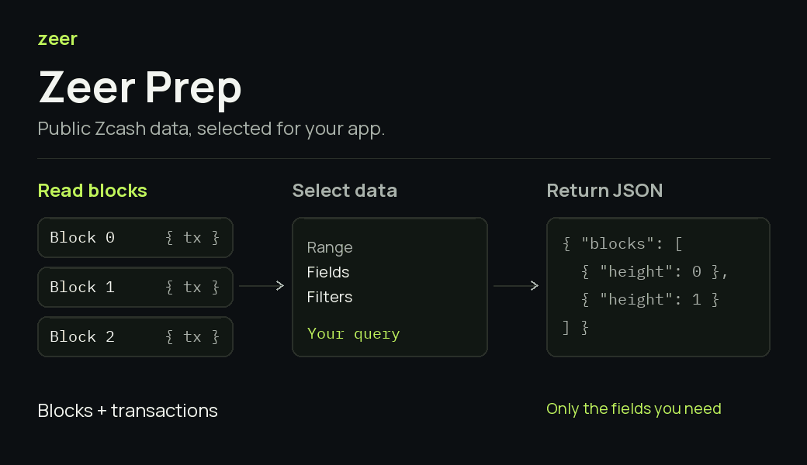
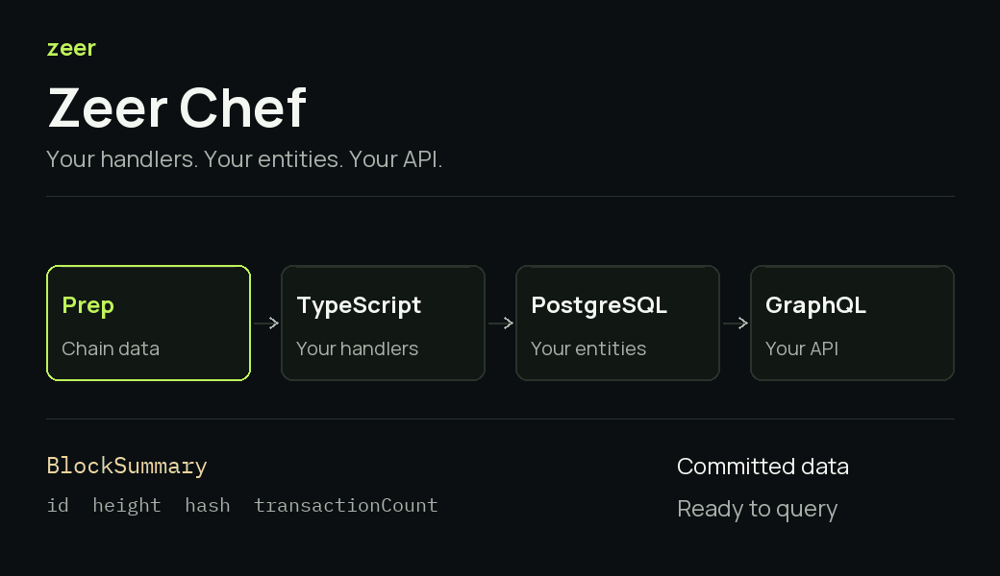

<div align="center">

# Zeer

**Zcash data. Ready to build.**

A public-chain data engine and an application-indexing framework for Zcash.

[Demo video · 1:55](https://github.com/EndPx/zeer/releases/tag/showcase-20261023) · [Live playground](https://zeer.endpx.cloud/app) · [Documentation](https://zeer.endpx.cloud/docs/) · [Quickstart](https://zeer.endpx.cloud/docs/chef/quickstart/) · [Reviewer walkthrough](docs/HACKATHON_DEMO.md)

[](https://www.npmjs.com/package/@zeer-dev/chef) [](https://www.npmjs.com/package/@zeer-dev/prep-client) [](https://zeer.endpx.cloud/app) [](LICENSE)

<picture>
  <source media="(prefers-reduced-motion: reduce)" srcset="assets/readme/zeer-overview.png">
  
</picture>

<sub>Original Remotion illustration. Plays once and settles into the complete data path.</sub>

</div>

## From chain data to application data

A transaction lookup is one part of a Zcash backend. An application also needs selected history, records that fit its domain, and a way to keep those records coherent when the chain changes.

Zeer connects those steps through two layers:

| Layer | What it does | Use it when |
| --- | --- | --- |
| **Chef** | Runs your TypeScript handlers, stores entities in PostgreSQL, and serves authenticated GraphQL with checkpoints and bounded recovery | Your application needs a persistent model and API |
| **Prep** | Serves public blocks and transactions through a Rust range/filter engine, with field selection and snapshot-aware continuation | You need chain data for a script, analysis pipeline or indexer |

Use Prep directly, or let Chef consume it. Your model, database and application policy remain yours.

## Try the working product

The public testnet playground requires **no account, wallet connection or API token**.

1. **[Query Prep](https://zeer.endpx.cloud/app/prep?example=headers&from=4515166&to=4515167).** Press **Run query** to inspect one real testnet block and its selected fields.
2. **[Query Chef](https://zeer.endpx.cloud/app/chef).** Try **Genesis block**, **Compare two heights**, or **Latest indexed block**, then run the GraphQL query.
3. **Read a shielded memo.** In the same Chef playground, select **Read shielded memos** and run it. The deliberately published demo receipt contains **Hello from Zeer Chef** and **100,000 zatoshi**.

The memo example reads a selected projection from Zeer's own testnet wallet. The public service accepts no viewing key. Your own receipts use the [local scanner workflow](https://zeer.endpx.cloud/docs/chef/shielded/local/).

A [fresh-browser reviewer check](docs/JUDGE_PREFLIGHT_20261023.md) completed these paths without cookies or developer credentials. Hosted demo projects have their own schemas; installing the SDK does not automatically upgrade them.

## Build your first indexer

Use **Node.js 24.14+**, **pnpm**, and **Linux x86_64 or WSL2**. You also need PostgreSQL, or Docker Engine with Compose v2 for the included local database.

```sh
pnpx @zeer-dev/cli@0.6.1 init
```

Choose **Public chain indexer**. Accept the default project folder, or use your own. Init creates files and local development credentials; it starts no services.

```sh
cd my-indexer
pnpm install
pnpm run db:up            # Skip if you configured an existing PostgreSQL database.
pnpm run dev --migrate    # Explicitly initialize a compatible project namespace.
```

In another terminal:

```sh
pnpm run query
```

The public starter captures Prep's available indexed height once, follows new blocks and exposes `BlockSummary` entities. Use a **blank** starter for your own schema, or a **shielded** starter with an explicit wallet birthday for a local inbox. Your project pins its SDK version.

[Complete quickstart](https://zeer.endpx.cloud/docs/chef/quickstart/) · [Quickstart with AI](https://zeer.endpx.cloud/docs/chef/quickstart-ai/) · [CLI reference](https://zeer.endpx.cloud/docs/chef/cli-commands/)

## Prep — select the data your application needs

Choose a block range, public transaction predicates and response fields. The typed client follows bounded pages through the captured snapshot, including pages with no matching transactions.

<picture>
  <source media="(prefers-reduced-motion: reduce)" srcset="apps/docs/static/demos/prep-flow.png">
  
</picture>

- Public transaction-ID lookup and transparent-output address matching.
- Separate Sapling, Orchard and Ironwood component filters.
- Exact decoded values, selected metadata, or raw transaction bytes.
- Explicit coverage, readiness, continuation and source-change outcomes.

[Prep quickstart](https://zeer.endpx.cloud/docs/prep/quickstart/) · [Query contract](https://zeer.endpx.cloud/docs/prep/query/) · [Recorded retrieval benchmarks](https://zeer.endpx.cloud/docs/prep/benchmarks/)

## Chef — define the model your application can query

Write a GraphQL entity schema and deterministic TypeScript handlers. Chef commits their changes, undo history and checkpoint together in PostgreSQL, then exposes the committed projection through GraphQL.

<picture>
  <source media="(prefers-reduced-motion: reduce)" srcset="apps/docs/static/demos/chef-flow.png">
  
</picture>

- Scalar fields, bounded lists, forward references and `@derivedFrom` relationships.
- Exact zatoshi values and transparent previous-output resolution.
- Bounded filters, deterministic ordering and revision-bound cursors.
- Snapshot-consistent reads, freshness metadata and explicit recovery errors.
- `dev`, read-only `doctor`, container recipes and namespace backup/restore helpers.

The illustration uses the [transaction breakdown example](examples/transaction-breakdown), a developer-defined model. The default public starter produces block summaries. Animations explain the engine; they are not live execution recordings or speed measurements.

[Entity schemas](https://zeer.endpx.cloud/docs/chef/schema/) · [GraphQL](https://zeer.endpx.cloud/docs/chef/graphql/) · [Recovery](https://zeer.endpx.cloud/docs/chef/recovery/) · [Self-hosting](https://zeer.endpx.cloud/docs/chef/self-hosting/)

## Authorized shielded receipts, in your environment

For an application that needs note values, receivers and memos, add Chef's local watch-only scanner. It uses an operator-owned **Unified Full Viewing Key** and supports Sapling, Orchard and Ironwood in the experimental testnet profile.

```text
Public transaction bytes from Prep
  → local scanner + protected UFVK
  → Chef receipt handler
  → operator PostgreSQL
  → authenticated application GraphQL
```

The UFVK stays with the operator and grants no spending authority. A receipt records an authorized note observation; it is not a spendable balance, sender identity or payment approval. Applications validate their own order, amount, receiver, confirmations and source canonicality before taking action.

[Local setup](https://zeer.endpx.cloud/docs/chef/shielded/local/) · [Receipt contract](docs/SHIELDED_RECEIPTS.md) · [Read memos](https://zeer.endpx.cloud/docs/chef/shielded/memos/)

## What you can build

| Application | Zeer's role |
| --- | --- |
| **Analytics dashboard** | Turn public blocks and transaction components into application aggregates |
| **Specialized explorer** | Model transactions, transparent inputs/outputs and their relationships |
| **Private payment inbox** | Index authorized note values and memos in the operator's environment |
| **Monitoring backend** | Supply a polling consumer with queryable observations and recovery context |

Invoices, campaigns, notification delivery, wallet state and settlement rules belong to the application. Chef's API is read-only; subscriptions, webhooks and a durable change feed are not included.

## Evidence you can inspect

| Evidence | What it establishes |
| --- | --- |
| **[0.6.1 release verification](docs/CHEF_061_ACCEPTANCE.md)** | Registry integrity, corrected README, exact launcher dependency and three registry-installed starters |
| **[0.6.0 functional acceptance](docs/CHEF_060_ACCEPTANCE.md)** | 187 Linux SDK tests without skips, native/PostgreSQL checks, and real testnet breakdown with restart; 0.6.1 runtime files are byte-identical |
| **[Six live shielded receipts](https://zeer.endpx.cloud/docs/chef/benchmarks/#shielded-receipts-six-uninterrupted-live-samples)** | Six future mined Ironwood notes in one observer, with values/memos, source rechecks and consumer recovery; recorded with Chef 0.2.0 |
| **[Anonymous reviewer journey](docs/JUDGE_PREFLIGHT_20261023.md)** | Fifteen browser steps and ten real queries, all HTTP 200 on the first attempt |
| **[24 October developer acceptance](docs/DEVELOPER_ACCEPTANCE_20261024.md)** | Fresh registry onboarding, PostgreSQL restart, address analytics rollback, 45 verified public docs pages, and another anonymous reviewer journey |
| **[23 October documentation audit](docs/DOCS_060_AUDIT.md)** | All 44 pages published at that milestone reviewed against the implemented API and examples |
| **[24 October consistency audit](docs/CLAIMS_CONSISTENCY_AUDIT_20261024.md)** | Website, 45 docs pages, package versions and repository contracts checked together; stale claims corrected and executable examples verified |

Performance results retain their original version, workload and timing boundaries. Compare [Prep retrieval](https://zeer.endpx.cloud/docs/prep/benchmarks/) separately from [Chef indexing and receipt processing](https://zeer.endpx.cloud/docs/chef/benchmarks/).

**Compact retrieval:** Prep downloaded **4,102,798 testnet compact blocks in a median of 32.28 seconds** across three runs. All **2,592,262 measured requests** across 48 measurements completed successfully, including workloads with 128 clients. This measures a warm prepared archive; acquisition, wallet scanning and decryption are outside the timer. [Results, published comparisons and hardware differences](https://zeer.endpx.cloud/docs/prep/benchmarks/#compact-block-retrieval) · [Reproduce](benchmarks/prep/compact-serving/README.md).

## Status

Zeer is a Zcash testnet developer preview. Public services are shared and bounded. Shielded scanning remains experimental; Zeer does not validate consensus or promise production availability. Recovery is bounded by retained history. The application remains responsible for financial execution.

## Explore the source

```text
apps/web/                Public website and Prep/Chef playgrounds
apps/docs/               Developer documentation
crates/prep/             Rust data engine and source follower
crates/prep-store/       Archive segments, catalog and indexes
crates/zeer-scanner/      Local watch-only note scanner
packages/chef/           TypeScript framework, PostgreSQL runtime and GraphQL
packages/cli/            Published one-command launcher
packages/prep-client/    Typed native-fetch client
examples/                Public indexers, transaction breakdown and private inbox
benchmarks/              Reproduction harnesses and source references
tools/product-visuals/   Reproducible Remotion illustrations
docs/                    Contracts, operational guides and scoped evidence
```

## Development

For framework development:

```sh
npm ci
npm run build:chef
npm run test:chef
npm run test:cli
```

Database and native-scanner cases require their documented environment; a skipped test is not integration evidence. Native development uses the pinned **Rust 1.99.0** toolchain and `Cargo.lock`. See [testing](https://zeer.endpx.cloud/docs/chef/testing/), [Prep engine commands](docs/PREP_ENGINE.md), and the [benchmark harnesses](benchmarks/README.md).

The visual source and regeneration instructions are in [tools/product-visuals](tools/product-visuals). The final [1:55 demo video](https://github.com/EndPx/zeer/releases/tag/showcase-20261023) is distributed as a separate release asset. Working video/audio exports and private operational files remain local.

## License

[MIT](LICENSE) for Zeer's original materials. Dependencies and referenced projects retain their own licenses.
