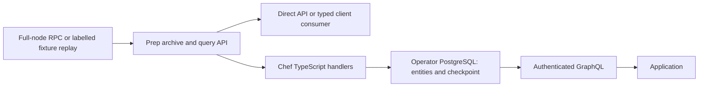

# Zeer public-data demo

Audience: developers evaluating complete public Zcash data retrieval and
application indexing. Target length: approximately three minutes after dependency
setup. Installation time is not part of this narrative and is not a benchmark.

## Preparation

Use the [quickstart](../examples/quickstart/README.md) on the candidate checkout.
Build and set up dependencies in advance, with an unused Compose project name.
Keep its PostgreSQL namespace empty for the first demo. Run the fixture and
PostgreSQL, ingest the captured range into Prep, and start Prep HTTP. Make the
source label visible: **three historical mainnet blocks replayed locally**.
Never introduce this source as the live Zcash network.

The demo uses the existing public example schema and handlers. No wallet, viewing
key, private memo, fee payment, hosted API or public npm package is involved.
API tokens are disposable local values; avoid displaying real deployment secrets.

## Sequence and narration

### 1. Independent Prep retrieval

Run `dc run --rm check --prep-only`, then show the field-selection request in
`examples/quickstart/check.mjs` and the Prep client documentation.

> Zcash applications need usable chain data before they can build useful APIs.
> Zeer Prep prepares complete blocks and transactions and lets an application
> request a bounded range and the public fields it needs. Applications can use
> Prep directly. In this demo the source is a fixed historical capture, and the
> check compares the raw bytes returned by Prep with that input.

### 2. A developer's schema and handler

Show `examples/chef-public/schema.graphql` and its TypeScript block/transaction
handlers. Explain the public fields being stored. Run the quickstart's explicit
code generation and migration commands, then sync through height 1687106.

> Chef adds the application layer. I define entities and TypeScript handlers,
> and Chef applies them to the public data from Prep. The database belongs to
> the operator. Entity changes and the checkpoint commit together for each block.

### 3. Query the application API

Start the API and run the quickstart's authenticated GraphQL curl request. Show
the checkpoint, a transaction identity and the returned public fields. Run
`dc run --rm check 1687106` to compare all entities, not just the first visible row.

> The application now reads its own projection through GraphQL. This is a
> generated, bounded read API for this schema. Encrypted shielded payloads stay
> encrypted; public transaction data does not reveal private recipients or memos.

### 4. Restart and finish the range

Use the documented stop/start sequence, sync through height 1687108, run
`dc run --rm check 1687108`, and repeat the same completed sync. Show the persisted
checkpoint and distinguish remaining work from work already committed.

Run `dc run --rm chef status --config examples/quickstart/chef.config.ts --human`
for the readable checkpoint, Prep coverage and freshness display. Use `--json`
when a script consumes the output. The source tip remains unknown for this
historical snapshot; do not describe its last captured block as today's tip.

> Restarting does not require starting the application index from scratch.
> Chef continues from its durable checkpoint. Repeating the completed range
> leaves the application state unchanged. The fixed demo source has no new
> blocks; live following and controlled reorg behavior are tested separately on
> an isolated real Regtest node.

### 5. Explain the boundary

> This release focuses on a self-hosted public-data pipeline, reproducible setup
> and explicit recovery. Private scanning, whole-chain scale, hosted services
> and public package distribution are separate work. The repository contains
> the implementation, input fixtures and reproduction instructions.

Stop only the demo services afterwards. Preserve the local verification outputs;
do not publish internal benchmark reports or invent comparative speed claims.

## Architecture

Prep trusts its source for consensus while checking its documented admission
invariants. Chef provides bounded application rollback/replay, not cross-chain
settlement or universal finality. A successful historical demo and controlled
Regtest proof do not establish natural P2P fault tolerance at mainnet scale.

## Recording and release notes

Record only after the chosen candidate passes installation and critical recovery
checks. Keep the candidate commit with the local demo record. This file supplies
a script; it is not a claim that a video has been recorded or uploaded. Submission,
public hosting and publication require their own requested action. The internal
28 October target is not a verified organizer cutoff or timezone.

On 14 October 2026, the public [Zecathon site](https://thezecathon.com/) directs
users to sign in for tracks, rules, schedule and the submission form. The exact
cutoff, timezone and authenticated submission fields were not verified in this
release check. Confirm those in the organizer account before submitting; this
technical candidate does not establish entry eligibility or deadline compliance.
