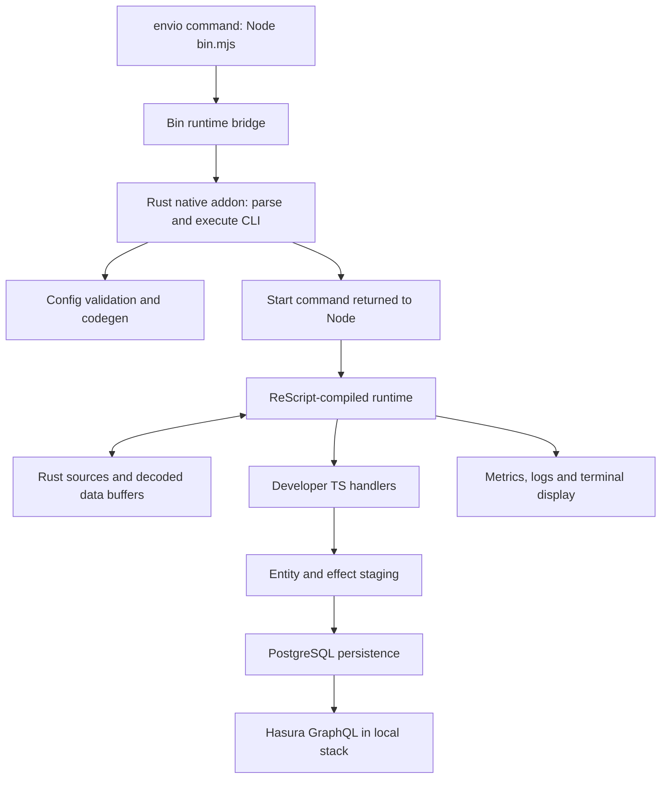

# Envio npm package and HyperIndex architecture research

Research date: 2026-10-12 (Asia/Jakarta).
Scope: published package structure, source architecture, developer API, code generation, storage/GraphQL, operational tooling, release pipeline, and the ReScript/Rust boundary.
Status: **source/documentation research only; no Envio installation, CLI execution, chain indexing, or benchmark run**.

This report supplements [the Zeer plan](../.omc/plans/zeer-v0.1.md). Recommendations here do not silently change its architecture or authorize implementation.

## 1. Evidence pinned for this investigation

| Item | Observed value |
| --- | --- |
| npm package | `envio` |
| Registry `latest` | `3.14.0` |
| Registry `next` | `3.14.1` |
| Publication of 3.14.0 | 2026-10-05T15:36:29.078Z |
| Matching Git tag | `v3.14.0` |
| Tag commit | `04e33b9da9980e35feb03bec847ea85a0a82e364` |
| Root package files | 292 |
| Compressed root tarball | 664,332 bytes |
| Unpacked root package | 2,674,762 bytes; native addon is a separate package |
| Consumer Node engine | `>=22.15.0` |
| Package module format | ESM |

The npm website returned HTTP 403 to the research fetcher. The official registry metadata and tarball were accessible. The tarball's SHA-512 matched the registry integrity field. `index.js`, `index.d.ts`, and `src/Core.res` matched the corresponding files at the pinned tag byte-for-byte. This is artifact/source correspondence evidence, not runtime validation or a package security audit.

Evidence was cached at `.omc/research/envio/` as metadata, tarball, extracted third-party source, selected tag source, and official documentation snapshots. This is research material, not Zeer implementation; exclude this cache from future product releases and avoid treating upstream code as our own source.

Registry links: [root metadata](https://registry.npmjs.org/envio/3.14.0), [Linux x64 companion metadata](https://registry.npmjs.org/envio-linux-x64/3.14.0). Repository reference: [pinned release](https://github.com/enviodev/hyperindex/tree/04e33b9da9980e35feb03bec847ea85a0a82e364).

## 2. What installing `envio` actually supplies

One user-facing dependency exposes several surfaces:

| Manifest/artifact | Purpose |
| --- | --- |
| `bin: envio -> bin.mjs` | Terminal command |
| `main: ./index.js` | JavaScript SDK exports |
| `types: ./index.d.ts` | TypeScript public declarations |
| `src/*.res.mjs` | Compiled runtime modules |
| `src/*.res` and `.resi` | ReScript sources/interfaces also shipped in the inspected tarball |
| `evm.schema.json`, `svm.schema.json`, `fuel.schema.json` | Configuration validation/editor support |
| `optionalDependencies` | Exact-version native packages selected by platform |
| `licenses/` | License overview and agreements shipped with the package |

The published root manifest has no lifecycle scripts. Build-only scripts/devDependencies are removed by the release builder. Consumers receive compiled JavaScript and a native addon rather than compiling the framework's ReScript/Rust during an ordinary supported-platform install.

Published native targets at this version:

- `envio-linux-x64` (glibc)
- `envio-linux-x64-musl`
- `envio-linux-arm64` (glibc)
- `envio-darwin-x64`
- `envio-darwin-arm64`

The platform package exposes `envio.node`, a Node native addon. There is no Windows native target in this release's loader; its explicit Windows error recommends WSL2. Missing optional packages produce actionable errors. Only a monorepo/dev version may fall back to a local Cargo build; published versions do not silently build Rust.

Sources: [package manifest](https://github.com/enviodev/hyperindex/blob/v3.14.0/packages/envio/package.json), [addon loader](https://github.com/enviodev/hyperindex/blob/v3.14.0/packages/envio/src/Core.res), [artifact builder](https://github.com/enviodev/hyperindex/blob/v3.14.0/packages/build-envio/src/build-artifact.ts).

## 3. Technology map

| Layer | Verified technology / responsibility |
| --- | --- |
| Package distribution | npm package plus platform-specific optional dependencies |
| CLI bootstrap | Node ESM `bin.mjs`, early Node-version validation |
| CLI/config/codegen | Rust; Clap, Inquire, Serde YAML/JSON, GraphQL parser and project generation code |
| Rust/Node bridge | napi-rs; a native `.node` module loaded into Node |
| Main runtime | ReScript compiled into ESM JavaScript, executed on Node |
| Handler API | TypeScript declarations and JavaScript values; TS/ReScript handler surfaces are ecosystem-dependent |
| Source/decode components | Rust EVM HyperSync/RPC, Fuel and Solana source modules, ABI parsing and columnar helpers |
| In-memory data structures | A mixture: Rust transaction/block/address stores and ReScript entity/effect/state structures |
| PostgreSQL path | ReScript persistence/storage modules with bindings to the Node `postgres` package |
| ClickHouse path | Rust ClickHouse components behind a storage/sink interface; optional, not a Zeer requirement |
| GraphQL for documented local stack | Hasura alongside PostgreSQL and the indexer |
| Terminal display | Rust TUI exposed through the addon; Ratatui appears in the Rust manifest |
| Logs/metrics | Pino and runtime metrics modules; HTTP operational endpoints |
| Tests/build | Vitest and TS tests; Cargo/Rust tests including snapshot/property tooling; CI artifact build/verification |

**TypeScript user code, ReScript runtime source, and Rust native implementation are different layers.** A developer importing `indexer` from `envio` does not have to write ReScript.

Sources: [Rust manifest](https://github.com/enviodev/hyperindex/blob/v3.14.0/packages/cli/Cargo.toml), [ReScript compilation config](https://github.com/enviodev/hyperindex/blob/v3.14.0/packages/envio/rescript.json), [PostgreSQL binding](https://github.com/enviodev/hyperindex/blob/v3.14.0/packages/envio/src/bindings/Postgres.res), [Core native interface](https://github.com/enviodev/hyperindex/blob/v3.14.0/packages/envio/src/Core.res).

## 4. Execution path from command to data



`bin.mjs` checks Node compatibility, imports `Bin`, and passes arguments. `Bin` calls Rust `runCli`. Some commands complete wholly in Rust; commands such as start/migrate return a structured command that the JS runtime dispatches. The distinction is visible on both sides of the N-API boundary.

The start path initializes persistence, loads/type-checks handlers, registers callbacks, and wires fetching, processing and rollback. Separate operation modules coordinate through `IndexerLoop`; state lives in `IndexerState`. The write loop snapshots staged changes, calls storage, and marks the committed frontier after storage completion. This is more than a CLI that forwards events directly into an HTTP endpoint.

Sources: [bin.mjs](https://github.com/enviodev/hyperindex/blob/v3.14.0/packages/envio/bin.mjs), [Bin.res](https://github.com/enviodev/hyperindex/blob/v3.14.0/packages/envio/src/Bin.res), [napi.rs](https://github.com/enviodev/hyperindex/blob/v3.14.0/packages/cli/src/napi.rs), [Main.res](https://github.com/enviodev/hyperindex/blob/v3.14.0/packages/envio/src/Main.res), [IndexerLoop.res](https://github.com/enviodev/hyperindex/blob/v3.14.0/packages/envio/src/IndexerLoop.res), [Writing.res](https://github.com/enviodev/hyperindex/blob/v3.14.0/packages/envio/src/Writing.res).

## 5. CLI surface and lifecycle semantics

| Command family | Responsibility |
| --- | --- |
| `envio init` | Guided templates/contract import; ecosystem/language/package-manager choices |
| `envio codegen` | Generate type information from config/schema |
| `envio dev` | Codegen, local service setup and development runtime |
| `envio start` | Codegen and runtime against configured existing infrastructure |
| `envio local docker up/down` | Local service lifecycle |
| `envio local db-migrate up/down/setup` | Database schema lifecycle; down/setup are destructive operations |
| `envio stop` | Local environment teardown; not a promise of a harmless pause |
| `envio metrics [runtime]` | Inspect running metrics |
| `envio config view` | Resolved configuration |
| `envio tools search-docs/fetch-docs` | Documentation access |
| `envio skills update` | Install/update shipped development skills |

The pinned source explicitly distinguishes `dev`, which manages local Docker services, from `start`, which expects services already available. Both regenerate types before launch. Database compatibility/reset decisions belong to the runtime; `--restart` forces reset. One local-development documentation paragraph says ordinary restart reindexes, but the pinned dev implementation allows compatible existing schemas to resume. Do not transfer that paragraph into Zeer's persistence contract without a runtime test.

Sources: [CLI reference](https://docs.envio.dev/docs/HyperIndex/cli-commands), [dev implementation](https://github.com/enviodev/hyperindex/blob/v3.14.0/packages/cli/src/executor/dev.rs), [command dispatch](https://github.com/enviodev/hyperindex/blob/v3.14.0/packages/cli/src/executor/mod.rs), [local-development guide](https://docs.envio.dev/docs/HyperIndex/running-locally).

## 6. SDK surface: verified v3 API

The main entry point exports `indexer`, `createTestIndexer`, `createEffect`, schema helpers under `S`, `BigDecimal`, and testing/type helpers. Framework internals should not be mistaken for stable public SDK methods.

| API | Use |
| --- | --- |
| `indexer.onEvent(options, handler)` | Register EVM/Fuel event processing |
| `indexer.onBlock(options, handler)` | Register supported block handlers |
| `indexer.contractRegister(options, handler)` | Discover/register dynamic contract addresses |
| `indexer.onInstruction(options, handler)` | Solana instruction processing |
| `indexer.onSlot(options, handler)` | Solana slot processing |
| `context.Entity.get(id)` | Async optional entity read |
| `context.Entity.getOrThrow(id)` | Async required entity read |
| `context.Entity.getWhere(filter)` | Async typed filtered reads |
| `context.Entity.getOrCreate(entity)` | Async read-or-initialize |
| `context.Entity.set(entity)` | Stage an entity mutation; returns void inside handlers |
| `context.Entity.deleteUnsafe(id)` | Stage deletion with the API's stated semantics |
| `context.log` | Structured handler logging |
| `context.chain` | Current chain and runtime state |
| `context.isPreload` | Whether this execution is the preload phase |
| `createEffect(...)`, `context.effect(...)` | Typed external calls with rate limits/caching options |
| `createTestIndexer()` | In-process test runner using the project's handlers |

An illustrative Envio v3 registration is:

```ts
import { indexer } from "envio";

indexer.onEvent(
  { contract: "Token", event: "Transfer" },
  async ({ event, context }) => {
    // Typed params and entity helpers depend on this project's generated types.
  },
);
```

This is not a Zeer API commitment. In particular, `onEvent` contract/ABI semantics cannot simply be renamed to detect private Zcash memos.

Source: [public declarations](https://github.com/enviodev/hyperindex/blob/v3.14.0/packages/envio/index.d.ts), especially handler context/entity operations around lines 566-615 and indexer exports around 2305-2308; [entry point](https://github.com/enviodev/hyperindex/blob/v3.14.0/packages/envio/index.js), [handler guide](https://docs.envio.dev/docs/HyperIndex/event-handlers).

## 7. Codegen: a significant v2/v3 distinction

Current v3 uses `.envio/types.d.ts` and a root `envio-env.d.ts` shim to specialize package types for a project. The familiar user import is from `envio`. The old v2 per-project `generated` package/runtime is no longer the current design.

Developer-authored inputs remain configuration, entity schema and handlers. Config/schema changes require regenerated declarations; runtime initialization also interprets configuration. Type generation alone does not create a trustworthy database state or prove handler correctness. The source also contains a generated ReScript handler surface for supported ecosystems; do not promise identical TS/ReScript support on every ecosystem.

For Zeer, a single package import backed by generated project types is a useful candidate. Our earlier examples described the desired behavior but did not settle whether to use module augmentation or an explicit generated typed wrapper. That decision should be tested for clear errors, editor support and isolation between project TS compilations.

Sources: [generated-files documentation](https://docs.envio.dev/docs/HyperIndex/generated-files), [Rust codegen implementation](https://github.com/enviodev/hyperindex/blob/v3.14.0/packages/cli/src/hbs_templating/codegen_templates.rs), [N-API generation interface](https://github.com/enviodev/hyperindex/blob/v3.14.0/packages/cli/src/napi.rs).

## 8. Performance mechanisms worth understanding

### Preload plus ordered processing

V3 documents an always-on two-phase handler model. In preload, handlers run concurrently to discover/batch entity reads and external effect work; entity writes are suppressed. In processing, handlers run in chain order against the in-memory state, including changes from earlier events. Thus a developer callback can execute more than once for one event. This matters for side effects and performance interpretation.

The benefit is reducing serialized I/O without abandoning ordered state transitions. It does not mean ReScript inherently outperforms Rust. Zeer should first prove deterministic single-pass correctness and measure DB/IPC/scanner costs; automatic two-pass callbacks would be a separate API contract requiring tests.

Sources: [preload guide](https://docs.envio.dev/docs/HyperIndex/preload-optimization), [EventProcessing](https://github.com/enviodev/hyperindex/blob/v3.14.0/packages/envio/src/EventProcessing.res), [BatchProcessing](https://github.com/enviodev/hyperindex/blob/v3.14.0/packages/envio/src/BatchProcessing.res).

### Effect API

Effects specify input/output schemas, rate limits and optional persistent caching; handlers call them through the context. Cache identity and cross-chain scope affect correctness. This is not a general exactly-once side-effect or rollback guarantee. The docs explicitly note notification behavior on reruns; database rollback cannot undo external HTTP actions.

Zeer's planned durable outbox remains distinct. Do not replace it with an arbitrary cached `fetch` callback because the interfaces look similar.

Source: [Effect API](https://docs.envio.dev/docs/HyperIndex/effect-api).

### Native sources, buffers, batching and workers

The inspected release includes Rust source adapters, native stores and JS-side scheduling/staging. The source has a supervisor/worker model for eligible independent per-chain workloads. These are particular architectural optimizations; a GitHub language percentage is not a measurement of where CPU time is spent. We have not reproduced any published speedup.

Sources: [native interface](https://github.com/enviodev/hyperindex/blob/v3.14.0/packages/envio/src/Core.res), [supervisor](https://github.com/enviodev/hyperindex/blob/v3.14.0/packages/envio/src/Supervisor.res), [September update](https://docs.envio.dev/blog/developer-update-september-2026).

## 9. Database, GraphQL and observability

The documented local/self-hosted stack has an indexer process, PostgreSQL and Hasura. Hasura provides the GraphQL query engine over indexed tables. The npm package contains Hasura integration/metadata handling; the existence of a GraphQL URL in the terminal does not imply a full GraphQL server is implemented inside the JS SDK.

The terminal screenshot is a TUI over runtime metrics: per-chain progress, counts, sync estimates and endpoint information. Rust source contains the renderer/session logic. Documentation specifies non-interactive behavior and an explicit TUI-disable option. Operational HTTP endpoints expose metrics and health independently of the interactive display.

For Zeer, retain separate scanned/enriched/committed progress and avoid printing viewing keys, private memos or API credentials. A UI can show the API location without exposing its secret. During initial catch-up a fixed target can support a percentage; ongoing chain following should show LIVE plus lag, not imply the chain is permanently 100% complete.

Sources: [self-hosting guide](https://docs.envio.dev/docs/HyperIndex/self-hosting), [Hasura integration](https://github.com/enviodev/hyperindex/blob/v3.14.0/packages/envio/src/Hasura.res), [TUI module](https://github.com/enviodev/hyperindex/blob/v3.14.0/packages/cli/src/tui/mod.rs), [observability](https://docs.envio.dev/docs/HyperIndex/observability).

## 10. Testing, reorg and release discipline

`createTestIndexer()` supports synthetic event processing and real source ranges, with entity inspection and per-block change results. Those are useful developer surfaces. A synthetic handler test is not a test of chain decoding or node behavior. The inspected runtime disables normal rollback in its test-mode branch, so the convenience test API alone must not be presented as production reorg validation.

Reorg documentation describes bounded rollback and explicitly excludes external side effects. Source modules separate detection, rollback, persisted history and committed progress. Their existence is evidence of design, not our verification of every edge case.

Release workflows require a successful Build & Verify run for the commit, build platform addons, publish platform packages, and publish the root package with matching versions. The workflow routes semver releases through `next`; the observed registry `latest` is a separate channel value. Consumers and research should pin what they actually use.

Sources: [testing documentation](https://docs.envio.dev/docs/HyperIndex/testing), [Main test-mode handling](https://github.com/enviodev/hyperindex/blob/v3.14.0/packages/envio/src/Main.res#L484), [reorg documentation](https://docs.envio.dev/docs/HyperIndex/reorgs-support), [publish workflow](https://github.com/enviodev/hyperindex/blob/v3.14.0/.github/workflows/publish.yml), [build verification](https://github.com/enviodev/hyperindex/blob/v3.14.0/.github/workflows/build_and_verify.yml).

## 11. Why ReScript instead of full Rust?

### Verified facts

- ReScript compiles to JavaScript; the package ships the resulting `.res.mjs` runtime.
- User TypeScript handlers execute in the Node environment with that runtime.
- Native Rust is already used extensively through N-API; this is not an all-ReScript architecture.
- ReScript has a static type system and JavaScript interoperability, as described by its own documentation.
- The repository uses typed variants/pattern matching to model state/control flow and also explicit unsafe casts at interop boundaries. Static typing does not eliminate boundary validation requirements.

Sources: [ReScript official site](https://rescript-lang.org/), [runtime compile configuration](https://github.com/enviodev/hyperindex/blob/v3.14.0/packages/envio/rescript.json), [Bin command variants](https://github.com/enviodev/hyperindex/blob/v3.14.0/packages/envio/src/Bin.res), [native boundary](https://github.com/enviodev/hyperindex/blob/v3.14.0/packages/envio/src/Core.res).

### Engineering interpretation, not a confirmed historical explanation from the authors

1. **A typed runtime in the same ecosystem as user handlers.** ReScript can provide typed state/control-flow modeling while compiling into the JavaScript environment that executes TS handlers and uses npm libraries.
2. **Put native work behind a targeted boundary.** Rust handles source/decoding/configuration/native structures; JS-side code can orchestrate user callbacks, async I/O and entity changes without moving every operation across a language boundary.
3. **Preserve developer ergonomics.** A Rust-first core supporting TypeScript handlers still needs a JS execution and interop strategy. Full native code is possible, but it does not remove that integration problem.
4. **Optimize measured bottlenecks.** Source latency, decoding, DB round trips, batching and ordering can dominate an indexer. Rewriting coordination code alone is not evidence of a speedup.

I did not locate a definitive maintainer design decision that states why ReScript was originally selected over Rust or TypeScript. Do not attribute team preference, staffing history or measured language superiority without such evidence.

## 12. Implications for Zeer

| Topic | Recommendation / decision status |
| --- | --- |
| Public distribution | Keep one user-facing npm package providing CLI and SDK; platform artifacts can remain internal distribution details |
| Handler language | Keep TypeScript; users should not need Rust or ReScript to write handlers |
| Runtime language | Keep TS as the proposed coordinator; no demonstrated requirement to add ReScript to our stack |
| Zcash integration | Rust/library reuse remains appropriate; no custom cryptography |
| Native boundary | Existing plan uses a child process, unlike Envio's N-API addon; retain for first feasibility proof and measure IPC cost before changing |
| Type generation | Evaluate single-package exports plus generated project declarations; keep generated internals out of user-edited files |
| CLI lifecycle | Specify dev/start/stop/replay behavior explicitly; ordinary stop must preserve Zeer state; resets are explicit |
| Progress UI | Build a small TUI/structured-log view from real committed metrics after the scanner works |
| DB writes | Keep framework-owned typed entity operations; developer owns DB infrastructure |
| GraphQL | Yoga is currently proposed for Zeer, while Envio local uses Hasura. Compare implementation burden and private-access requirements in G0/G2; do not imply Envio validates our selection |
| Performance | Benchmark batching, source/enrichment, DB and IPC separately before adding two-pass execution or native rewrites |
| Testing helpers | A small fixture-based `createTestIndexer`-style API is a valuable later SDK surface; name/contract remains proposed and distinct from scanner/reorg tests |
| Scope | No EVM ABI import, factory discovery, Solana, ClickHouse, cloud management or Effect API parity required for Zeer v0.1 |

These recommendations concern architecture and developer experience. They are not a proposal to fork the package or make Zeer depend on `envio`.

## 13. Licensing observations

The root package points to `licenses/README.md`, and Envio's own licensing page says its license is not OSI-recognized and describes limits around competing hosted services. The companion package metadata reports `GPL-3.0`, which differs from the root's license declaration. Do not infer one permissive license for every component from a public GitHub repository or one npm metadata field.

For Zeer, independently implement the desired workflow using appropriately licensed dependencies. Any proposal to copy, modify, redistribute or depend on Envio code needs a component-specific license determination first. This research does not settle legal compatibility.

Sources: [official licensing](https://docs.envio.dev/docs/HyperIndex/licensing), [root license overview](https://github.com/enviodev/hyperindex/blob/v3.14.0/licenses/README.md), [native package metadata](https://registry.npmjs.org/envio-linux-x64/3.14.0).

## 14. Limits and completion of this research

Covered: root artifact inventory, entry points, public type surface, native loading, codegen, core scheduling/persistence/recovery paths, SDK testing, TUI, dependency manifests, release workflows, official docs and Zeer implications.

Not claimed: every line audited, native binaries executed, dependency supply chain audited, every supported platform tested, live Envio Cloud inspected, benchmark numbers reproduced, or maintainer motivation independently confirmed.

The next useful step is to refine Zeer's package/API contract with these findings, then perform the existing G0/G1 feasibility work when implementation is requested. The research by itself does not justify adding ReScript or replacing the Rust child-process design.
